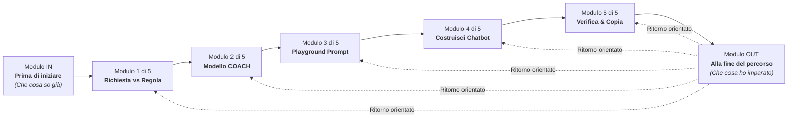

# MAESTRO CIUCHINO — DOCUMENTAZIONE TECNICA E PEDAGOGICA DI PROGETTO
> **Scopo del documento**: File di contesto e architettura completo per l'ingestione nel *Second Brain* e la comprensione approfondita da parte di agenti AI.  
> **Versione Progetto**: 2.0 (Include Modulo IN, Moduli 1–5, Modulo OUT)  
> **Ultimo Aggiornamento**: Settembre 2026  
> **Target Utente**: Docenti della scuola italiana (Infanzia, Primaria, Secondaria di I Grado), anche con scarse o nulle competenze informatiche pregresse.

---

## 1. VISIONE E MISSIONE PEDAGOGICA

### 1.1 Premessa e Finalità
**Maestro Ciuchino** è una web application formativa e interattiva (*AI Prompt Simulator*) progettata per accompagnare i docenti nell'apprendimento della progettazione di prompt efficaci e nella costruzione di **System Prompt permanenti** (assistenti didattici su misura).

L'obiettivo cardine non è "insegnare informatica", bensì **sviluppare consapevolezza metodologica ed etica**:
1. **L'IA propone, il docente dispone**: Nessuna decisione didattica, scelta metodologica o valutazione degli alunni è delegabile all'algoritmo.
2. **Dal prompt usa-e-getta all'assistente stabile**: Superare la frammentazione delle richieste quotidiane per creare assistenti disciplinari/di sezione riutilizzabili.
3. **Trasparenza pedagogica e controllo**: Imparare a esigere dall'IA cosa ha aggiunto, tagliato o dedotto rispetto alle istruzioni del docente.
4. **Privacy assoluta (Zero dati personali)**: Formare all'anonimizzazione preventiva e rigorosa di qualunque informazione riguardante minori, famiglie e diagnosi cliniche.

### 1.2 Principi di Linguaggio ed Ergonomia Cognitiva
- **Nessun linguaggio valutativo**: L'applicazione **non è un test, non assegna voti, punteggi, percentuali o giudizi sulla persona**. Non esistono concetti come "superato/bocciato". Si utilizzano indicatori orientativi come:
  - *"Argomento chiaro"*
  - *"Da riprendere"*
  - *"Su questo conviene tornare"*
  - *"Vale la pena rivedere"*
- **Apprendimento per tentativi ed errore costruttivo**: Tutti i quesiti e i mini-quiz consentono **tentativi illimitati**. In caso di errore, il feedback spiega immediatamente il concetto chiave in linguaggio semplice senza rivelare subito la risposta corretta.
- **Agency attiva del docente**: Il docente è sempre il soggetto grammaticale e operativo (es. *"Includi sempre questa regola"* e non forme passive come *"la regola viene inserita"*).
- **Prosa reale, non etichettata**: I prompt d'esempio e i quiz presentano testi in prosa continua e fluida, esattamente come li scriverebbe un docente reale, senza pre-etichettare le sezioni (*"Contesto:"*, *"Obiettivo:"*, ecc.).

---

## 2. IL MODELLO C.O.A.C.H.

Il cuore metodologico dell'applicazione è il framework **COACH**, un acronimo mnemonico ideato per strutturare prompt pedagogicamente solidi:

| Lettera | Elemento | Significato Didattico | Domanda Guida per il Docente |
| :---: | :--- | :--- | :--- |
| **C** | **Contesto** | Chi è l'assistente, a quale classe/fascia si rivolge, livello di autonomia e bisogni del gruppo. | *Chi è il bot e a chi parla?* |
| **O** | **Obiettivo** | Lo scopo didattico preciso dell'attività (materia, traguardo di competenza, compito). | *Cosa vogliamo ottenere concretamente?* |
| **A** | **Azione** | Le istruzioni operative: cosa incollerà il docente e quale formato di output deve produrre il bot. | *Quali passaggi precisi deve seguire l'IA?* |
| **C** | **Criteri** | I vincoli rigorosi: lunghezza, complessità lessicale, divieto di allucinazioni, esclusioni esplicite. | *Quali limiti non deve superare?* |
| **H** | **Hai il controllo** | La **Dichiarazione delle Modifiche**: la clausola etica con cui l'IA esplicita tagli, aggiunte o assunzioni. | *Cosa ha cambiato o dedotto l'IA?* |

### Formula Universale della Trasparenza (Casella H)
Identica per tutti gli ordini scolastici (Infanzia, Primaria, Secondaria):
> *"Alla fine di ogni risposta aggiungi una sezione «Dichiarazione modifiche» in cui elenchi che cosa hai aggiunto, semplificato o dedotto rispetto a quanto richiesto, e ogni informazione che il docente deve verificare."*

---

## 3. STRUTTURA DEL PERCORSO FORMATIVO (7 MODULI)

Il percorso è composto da **5 moduli numerati (1–5)** e **2 moduli formativi/orientativi (IN e OUT)**.  
La numerazione 1–5 è rigorosamente preservata per non alterare la scansione didattica centrale.



### 3.1 Modulo IN — "Che cosa so già" (Prima di iniziare)
- **Scopo**: Colmare preventivamente eventuali lacune sui concetti fondamentali dell'IA generativa.
- **Natura**: Universale (non differenziato per fascia scolastica).
- **Argomenti (6 quesiti)**:
  1. *Natura probabilistica*: L'IA non "pensa", calcola la parola statisticamente successiva.
  2. *Allucinazioni e fonti*: Un testo sicuro e formale può contenere dati o citazioni inventate.
  3. *Privacy e dati personali*: Divieto assoluto di inserire nomi di alunni, diagnosi o dati familiari.
  4. *Memoria tra chat*: Gli strumenti memorizzano dettagli tra sessioni diverse (anche nei piani gratuiti).
  5. *Primato del docente*: La valutazione e la responsabilità educativa non sono mai delegabili.
  6. *Variabilità delle risposte*: A parità di prompt, l'output può variare a causa della natura stocastica.
- **Funzionalità chiave**: Salto rapido al Modulo 1 sempre disponibile; riepilogo finale contenente **solo i concetti su cui il docente è stato incerto**.

### 3.2 Modulo 1 — "Chiedere una cosa o stabilire una regola" (Modulo 1 di 5)
- **Scopo**: Chiarire la differenza tra *Richiesta Singola (Prompt usa-e-getta)* e *Istruzione Permanente (System Prompt)*.
- **Contenuti**:
  - Metafore visive (il bigliettino volante vs il diario di bordo).
  - Confronto pratico interattivo Prima/Dopo differenziato per fascia.
  - Mini-quiz su 3 scenari scolastici reali (riprovabile senza limiti).

### 3.3 Modulo 2 — "Il Modello COACH" (Modulo 2 di 5)
- **Scopo**: Scomporre e comprendere i 5 pilastri della comunicazione efficace con l'IA.
- **Contenuti**:
  - Schede interattive per ciascun pilastro con consigli didattici.
  - Esempio guidato unitario (caso didattico coerente per materia e classe).
  - Mini-quiz di riconoscimento in prosa continua: il docente individua l'elemento mancante in prompt reali scritti da colleghi.

### 3.4 Modulo 3 — "Playground Prompt" (Modulo 3 di 5)
- **Scopo**: Esercitarsi nella scrittura di prompt completi con riscontro immediato.
- **Contenuti**:
  - Editor di testo con checklist interattiva dei 5 elementi COACH.
  - Pulsante per caricare casi didattici completi o pulire il campo.
  - Simulatore di risposta IA fedele al prompt, che include la simulazione della *Dichiarazione Modifiche*.

### 3.5 Modulo 4 — "Costruisci Chatbot" (Modulo 4 di 5)
- **Scopo**: Wizard interattivo in 5 step per assemblare il proprio System Prompt permanente.
- **Contenuti**:
  - Step 1: Ruolo e Identità (C)
  - Step 2: Contesto Didattico e Target (C)
  - Step 3: Input Atteso & Azioni del Bot (A)
  - Step 4: Criteri e Limiti (C)
  - Step 5: Dichiarazione Modifiche & Controllo Docente (H) — Etichettato con badge `"DA INCLUDERE SEMPRE"`, campo `textarea` modificabile, pulizia del singolo campo, validatore di completezza reattivo.
  - Visualizzatore dinamico del System Prompt generato in tempo reale.

### 3.6 Modulo 5 — "Verifica Pedagogica & Export" (Modulo 5 di 5)
- **Scopo**: Eseguire l'ultima revisione critica prima dell'uso in classe e trasferire il prompt nelle piattaforme IA.
- **Contenuti**:
  - Checklist pedagogica non delegabile (Corrispondenza, Accuratezza, Adeguatezza d'età, Assenza bias, Privacy).
  - Guida operativa per l'esportazione verso **ChatGPT** (Custom GPT/Progetti), **Google Gemini** (Gems) e **Claude** (Projects).
  - Pulsanti per copiare il prompt negli appunti o scaricarlo in file `.txt`.

### 3.7 Modulo OUT — "Che cosa ho imparato" (Alla fine del percorso)
- **Scopo**: Orientamento post-laboratorio: indica quali moduli conviene riprendere senza emettere voti.
- **Natura**: **Differenziato per ordine di scuola** (Infanzia, Primaria, Secondaria).
- **Argomenti (5 quesiti contestualizzati)**:
  1. *Modulo 1*: Prompt singolo vs System prompt permanente.
  2. *Moduli 2 & 3*: Riconoscimento elementi COACH in prosa reale.
  3. *Modulo 4*: Ruolo e vigilanza sulla Dichiarazione Modifiche (clausola H).
  4. *Modulo 5*: Verifiche qualitative ed etiche che competono solo all'insegnante.
  5. *Privacy*: Formulazione corretta di richieste didattiche anonime.
- **Funzionalità chiave**:
  - Guida finale con riquadri informativi e **pulsanti di salto diretto** (`🔍 Vai al Modulo X ➔`).
  - Se tutti i concetti sono chiari, messaggio sintetico e sobrio.
  - Pulsante separato `🔄 Ricomincia da capo` con finestra di conferma e avviso di non reversibilità.

---

## 4. ARCHITETTURA TECNICA DEL SOFTWARE

### 4.1 Stack Tecnologico
- **Frontend**: Vanilla HTML5, CSS3 moderno (Custom Properties, CSS Grid, Flexbox), Vanilla JavaScript (ES6+).
- **Nessun framework pesante**: Nessuna dipendenza da React, Vue, Angular o build tool complessi (Webpack, Vite).
- **Zero-CORS & Standalone**: L'applicazione può essere eseguita sia tramite server web locale (`http://localhost:8080`) sia aprendo direttamente `index.html` via `file:///` nel browser.

### 4.2 Mappa dei File e Responsabilità

```
AI Prompt simulator/
├── index.html                  # Scheletro HTML5 accessibile, modali e container
├── css/
│   └── style.css               # Design system, variabili tematiche, media queries
├── js/
│   ├── app.js                  # Entry point router, navigazione a 7 moduli, popover
│   ├── app.bundle.js           # Bundle monolitico per esecuzione standalone zero-CORS
│   ├── state.js                # AppState: stato reattivo e sincronizzazione LocalStorage
│   ├── data/
│   │   └── schoolData.js       # Repository dei contenuti, quiz, prompt e preset
│   └── modules/
│       ├── moduleIN.js         # Render e logica Modulo IN ("Che cosa so già")
│       ├── module1.js          # Render e logica Modulo 1 ("Richiesta vs Regola")
│       ├── module2.js          # Render e logica Modulo 2 ("Modello COACH")
│       ├── module3.js          # Render e logica Modulo 3 ("Playground Prompt")
│       ├── module4.js          # Render e logica Modulo 4 ("Costruisci Chatbot")
│       ├── module5.js          # Render e logica Modulo 5 ("Verifica & Export")
│       └── moduleOUT.js        # Render e logica Modulo OUT ("Che cosa ho imparato")
├── assets/
│   └── maestro_ciuchino.png    # Mascotte e identità visiva del progetto
├── build_bundle.ps1            # Script PowerShell per la ricompilazione di app.bundle.js
├── serve.ps1                   # Script PowerShell per il server web locale (porta 8080)
└── PROJECT_DOCUMENTATION.md    # Questo documento di sintesi per il Second Brain
```

### 4.3 Gestione dello Stato (`js/state.js`)
Lo stato applicativo è centralizzato nell'oggetto `AppState` e salvato in `localStorage` con chiave `maestro_ciuchino_state_v1`:

```javascript
const defaultState = {
  currentModule: 'in', // 'in' | 1 | 2 | 3 | 4 | 5 | 'out'
  currentLevel: 'primaria', // 'infanzia' | 'primaria' | 'secondaria'
  completedModules: {
    in: false,
    1: false,
    2: false,
    3: false,
    4: false,
    5: false,
    out: false
  },
  mInQuizAnswers: {},   // { [qId]: { selectedIdx, isCorrect, retryCount } }
  m1QuizAnswers: {},    // { [qId]: { selectedIdx, isCorrect, feedbackText, isSolved } }
  m2PillarInputs: { c: '', o: '', a: '', crit: '', h: '' },
  m2QuizAnswers: {},    // { [quizId]: { selectedIdx, isCorrect, feedbackText } }
  m3PromptText: '',
  m3CoachChecks: { c: false, o: false, a: false, crit: false, h: false },
  m4BotData: {
    role: '',
    context: '',
    objective: '',
    actionInput: '',
    criteria: '',
    transparencyClause: ''
  },
  m5Checklist: {
    check_match: false,
    check_accuracy: false,
    check_age: false,
    check_nobias: false,
    check_privacy: false
  },
  mOutQuizAnswers: {}   // { [qId]: { selectedIdx, isCorrect, retryCount } }
};
```

---

## 5. REGOLE GUIDA PER AGENTI AI CHE COLLABORANO SUL PROGETTO

Se un altro agente AI deve apportare modifiche o estendere il progetto, deve attenersi a queste **regole tassative**:

1. **Dual-File Synchronization (Bundle vs Moduli)**:
   - `index.html` carica `js/app.bundle.js`.
   - Il codice sorgente risiede in `js/modules/`, `js/data/schoolData.js`, `js/state.js` e `js/app.js`.
   - **Regola**: Ogni modifica apportata ai file modulari deve essere immediatamente riflessa in `js/app.bundle.js` (eseguendo `.\build_bundle.ps1` o aggiornando il bundle).
2. **Preservazione della Numerazione 1–5**:
   - Non rinumerare mai i Moduli 1–5 in Moduli 1–7. I nuovi moduli si chiamano **Modulo IN** e **Modulo OUT**.
3. **Divieto di Lessico Valutativo**:
   - Non inserire percentuali di successo, voti, punteggi ("3/5 risposte esatte"), barre numeriche o parole come "test", "esame", "superato", "bocciato", "errore".
4. **Tentativi Illimitati e Feedback Socratico**:
   - I quiz non devono mai bloccarsi al primo errore né rivelare la risposta corretta al primo tentativo errato. L'utente deve poter riprovare dopo aver letto la spiegazione.
5. **Autonomia Didattica e Subjectivity del Docente**:
   - Mai usare formule come *"l'app inserisce la regola"* o *"il bot garantisce"*. Il docente è colui che imposta, esige e verifica.

---

## 6. SINTESI CONCLUSIVA
*Maestro Ciuchino* è un ponte tra l'innovazione tecnologica dell'intelligenza artificiale generativa e la cura pedagogica della scuola pubblica italiana. Attraverso il modello COACH e un ambiente protetto, trasforma la diffidenza o l'entusiasmo acritico in una competenza professionale solida, etica e replicabile.
